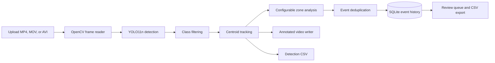
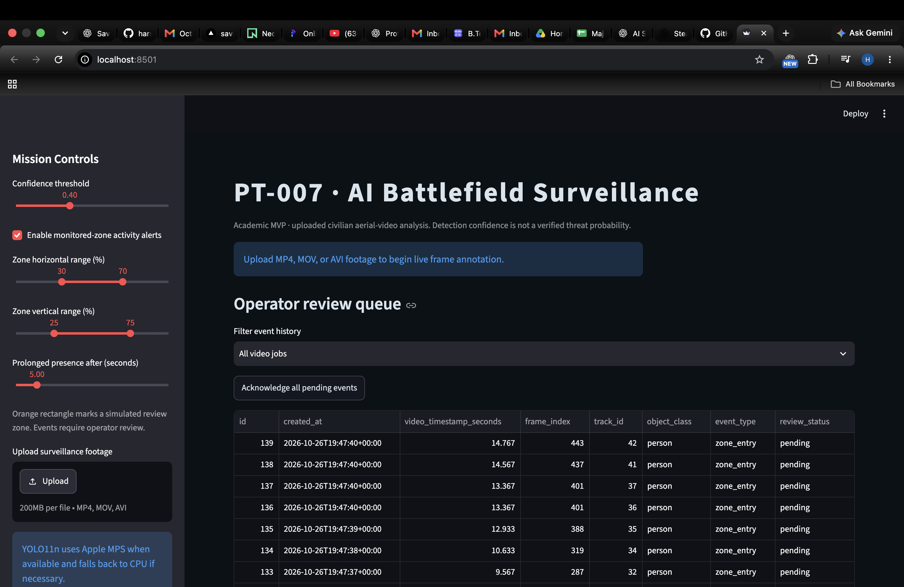
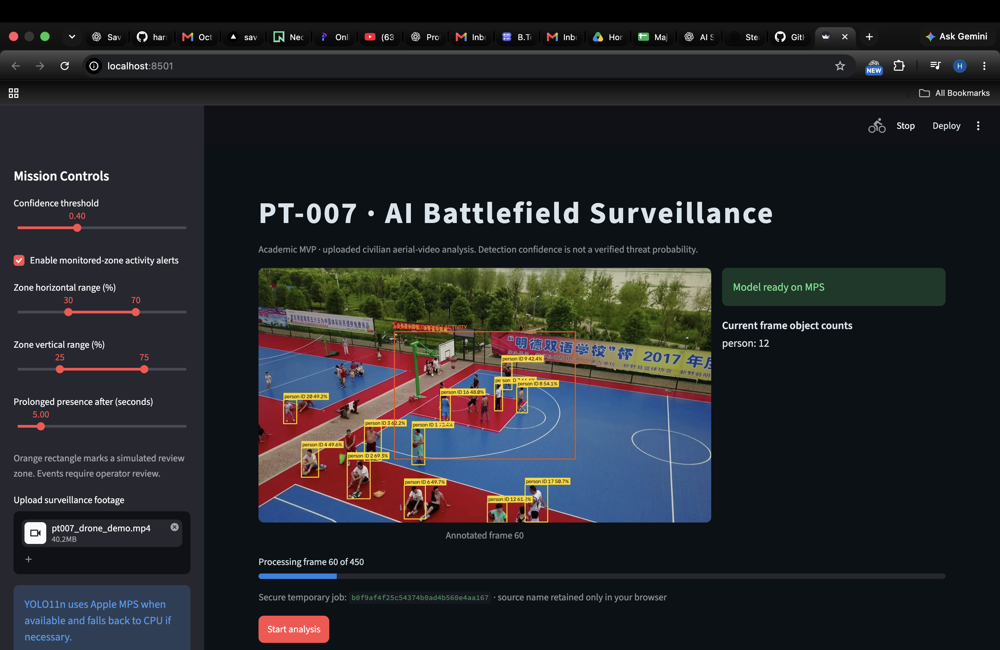
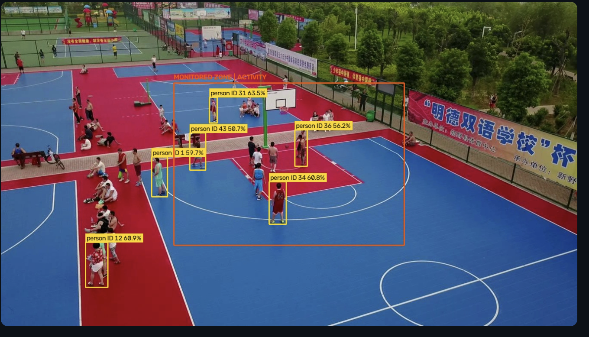
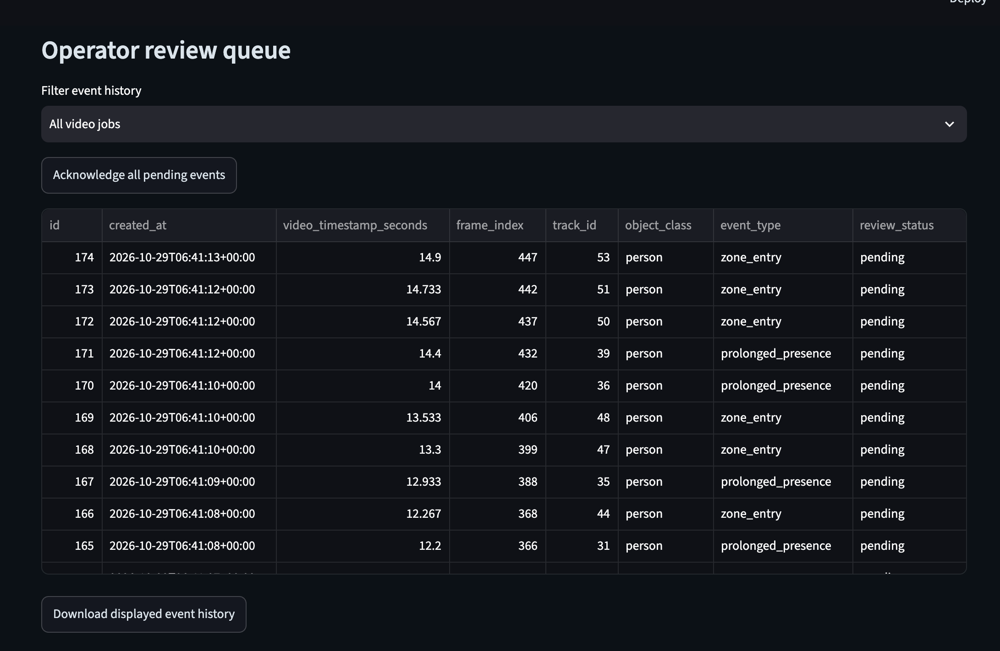
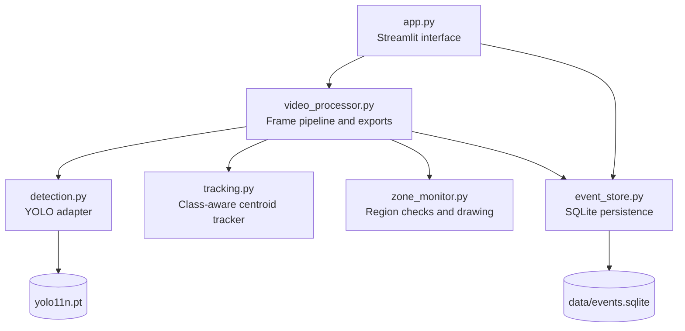
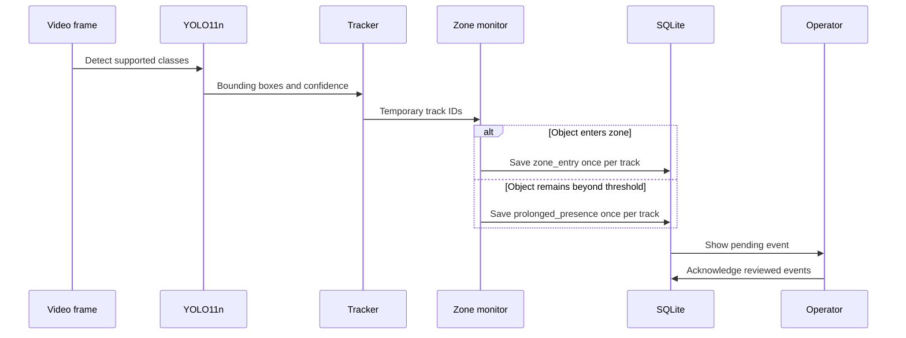
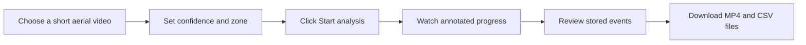
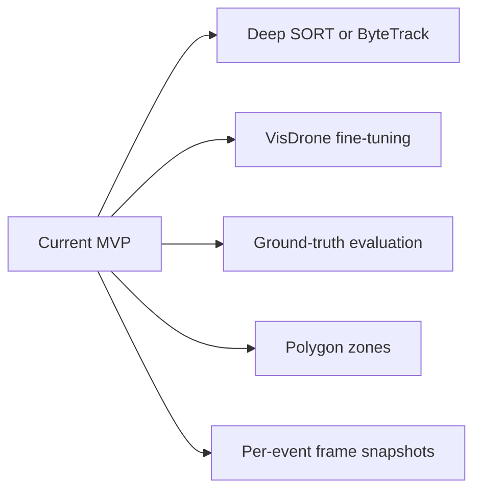

<div align="center">

# PT-007

### AI-Based Battlefield Surveillance and Threat Detection System

**A college major project for explainable object detection, tracking, zone monitoring, and human-reviewed activity analysis in uploaded civilian aerial video.**


> Built as an academic proof of concept using prerecorded civilian aerial footage. The system does not identify hostility, estimate threat probability, control hardware, or make autonomous decisions.

</div>

---

## Project at a glance

PT-007 turns an uploaded video into a reviewable analysis package. It detects supported objects with YOLO11n, links detections across frames with temporary tracking IDs, watches a configurable region, records activity events, and gives the operator annotated video and CSV exports.

| Capability | What the project currently does |
| --- | --- |
| Object detection | Detects `person`, `car`, `truck`, `bus`, `motorcycle`, and `bicycle` |
| Object tracking | Assigns temporary class-aware IDs across nearby frames |
| Zone monitoring | Uses an adjustable orange rectangle as a simulated review zone |
| Activity events | Records deduplicated `zone_entry` and `prolonged_presence` events |
| Human review | Stores events in SQLite with pending or acknowledged status |
| Evidence export | Produces annotated MP4, detection CSV, and event-history CSV |
| Hardware support | Uses Apple MPS when available and falls back to CPU |

## Why this project exists

Reviewing aerial video frame by frame is repetitive and makes it easy to miss short events. PT-007 explores a simple question: can a compact, locally running pipeline turn prerecorded aerial footage into structured observations that a human can inspect more quickly?

The project keeps the operator in control. A detection is only a model observation, and a zone event is only a prompt for review. Neither is treated as a verified threat.

## System workflow



The UI exposes the confidence threshold, horizontal and vertical zone bounds, and prolonged-presence duration. Processing happens locally, one frame at a time.

## Application evidence

### 1. Dashboard and persistent event history

The dashboard loads saved events before a new video is uploaded. Operators can filter history by video job, acknowledge pending records, and export the displayed table.



### 2. Live frame processing

During analysis, the dashboard shows the current annotated frame, model device, current frame object counts, and processing progress. The result below shows YOLO inference running through Apple MPS.



### 3. Tracking and monitored-zone result

Each yellow label contains the detected class, temporary track ID, and detection confidence. The orange rectangle is the configurable monitored zone. `MONITORED ZONE | ACTIVITY` means at least one supported tracked object is currently inside the region.



### 4. Human review queue

Zone events are persisted with a stable database ID, creation timestamp, video timestamp, frame index, track ID, class, event type, and review status.



## Architecture



The detection layer remains independent of Streamlit. This makes it easier to improve tracking or event logic without rewriting model inference or the dashboard.

## How event generation works



Event deduplication uses `job_id`, `frame_index`, `track_id`, and `event_type`. Streamlit reruns therefore do not create another copy of the same logical event.

## Technology stack

| Component | Choice | Purpose |
| --- | --- | --- |
| Language | Python 3.11+ | Application and processing logic |
| Detection | Ultralytics YOLO11n | Pretrained COCO object detection |
| Video | OpenCV | Frame input, annotation, and output encoding |
| Dashboard | Streamlit | Uploads, controls, progress, review, and downloads |
| Data analysis | pandas | Detection and event CSV generation |
| Persistence | SQLite | Durable event history and review status |
| Acceleration | PyTorch MPS or CPU | Apple Silicon acceleration with safe fallback |

## Supported observations

Only the following pretrained COCO classes are retained:

```text
person  car  truck  bus  motorcycle  bicycle
```

No custom dataset or custom model training is required. On the first run, Ultralytics downloads the official `yolo11n.pt` weights if they are not already present.

## Installation

### Prerequisites

- Python 3.11 or newer
- macOS, Linux, or Windows
- Internet access on the first run if `yolo11n.pt` is not present

### Setup

```bash
git clone https://github.com/harshitcodes1308/PT-007-AI-Based-Battlefield-Surveillance-and-Threat-Detection-System.git
cd PT-007-AI-Based-Battlefield-Surveillance-and-Threat-Detection-System

python3 -m venv .venv
source .venv/bin/activate
pip install --upgrade pip
pip install -r requirements.txt
```

On Windows PowerShell, activate the environment with:

```powershell
.venv\Scripts\Activate.ps1
```

## Run the dashboard

```bash
streamlit run app.py
```

Open the local URL printed by Streamlit, normally `http://localhost:8501`.



## Dashboard controls

| Control | Meaning |
| --- | --- |
| Confidence threshold | Minimum YOLO detection confidence retained by the pipeline |
| Enable monitored-zone activity alerts | Turns simulated zone event creation on or off |
| Zone horizontal range | Sets the left and right limits as percentages of frame width |
| Zone vertical range | Sets the top and bottom limits as percentages of frame height |
| Prolonged presence after | Sets how long a track must remain inside before an event is recorded |
| Filter event history | Shows all jobs or one selected job without deleting other history |
| Acknowledge all pending events | Updates displayed pending events in SQLite |

## Generated outputs

### Detection CSV

| Column | Description |
| --- | --- |
| `timestamp_seconds` | Video time for the detection |
| `frame_index` | Zero-based source frame number |
| `class` | Supported COCO class name |
| `confidence` | YOLO detection confidence |
| `x1`, `y1`, `x2`, `y2` | Bounding-box pixel coordinates |
| `track_id` | Temporary within-video tracking identifier |

### Event history

| Column | Description |
| --- | --- |
| `id` | Stable SQLite event identifier |
| `created_at` | UTC time when the record was stored |
| `video_timestamp_seconds` | Position of the event in the uploaded video |
| `frame_index` | Source frame where the event was generated |
| `track_id` | Temporary track associated with the event |
| `object_class` | Detected object category |
| `event_type` | `zone_entry` or `prolonged_presence` |
| `review_status` | `pending` or `acknowledged` |

Persistent history is stored in `data/events.sqlite`. Temporary uploads and generated job outputs are written below `runtime/` and are excluded from Git.

## Project structure

```text
.
├── app.py                 Streamlit dashboard and job orchestration
├── detection.py           YOLO11n loading, MPS fallback, and class filtering
├── tracking.py            Lightweight class-aware object association
├── zone_monitor.py        Configurable region checks and overlay drawing
├── video_processor.py     Frame processing, annotation, CSV, and video output
├── event_store.py         SQLite schema, migration, review, and deduplication
├── tests/
│   └── smoke_test.py      End-to-end synthetic pipeline and persistence test
├── docs/
│   └── images/            Demonstration and result screenshots
├── data/
│   └── events.sqlite      Local persistent history, created automatically
├── requirements.txt
└── README.md
```

## Testing

Run the smoke test from the project root:

```bash
source .venv/bin/activate
python tests/smoke_test.py
```

The smoke test creates a small synthetic video and verifies:

- frame processing and annotated-video output
- detection CSV generation
- stable tracking for a moving test object
- one `zone_entry` and one `prolonged_presence` event
- SQLite persistence across separate connections
- acknowledgment status updates
- duplicate-event prevention across reruns

The synthetic test validates integration behavior. It does not measure detection accuracy. Real model behavior should be evaluated separately with labeled ground-truth data.

## Design choices

### Why YOLO11n?

YOLO11n provides a practical balance for a laptop demonstration. It is small enough for local inference and uses pretrained COCO classes, so the project can demonstrate the complete pipeline without custom training.

### Why a lightweight centroid tracker?

The current tracker avoids another neural-network dependency and works well enough for short, continuous demonstration clips. It associates boxes by class and center distance. This keeps the pipeline understandable for an academic presentation.

### Why SQLite?

SQLite gives the review queue durable history without running a separate database server. Events remain available after Streamlit restarts, and acknowledgment changes are committed immediately.

## Known limitations

- Tracking IDs are temporary associations, not verified identities.
- IDs may change after occlusion, abrupt camera motion, large object movement, or missed detections.
- A zone event describes geometric activity inside a rectangle. It does not describe intent or hostility.
- Detection confidence is a model score, not a calibrated probability of correctness or danger.
- The pretrained COCO model may miss small aerial objects because no VisDrone-specific fine-tuning has been performed.
- H.264 output depends on the codecs available to the local OpenCV build. The application falls back to `mp4v` when required.
- No accuracy, precision, recall, or threat-detection claims are made without a labeled evaluation dataset.

## Future improvements



These extensions should preserve the same principle used by the current system: model outputs remain reviewable observations, and final interpretation belongs to a human operator.

## Academic note

This repository is an educational prototype created for a college major-project demonstration. The title reflects the original project theme, while the implemented experiment uses uploaded civilian aerial footage and general-purpose computer-vision methods.

## Contributors

Developed as a B.Tech major project at **IILM University, Greater Noida**.

## License

Add the license selected by the project team before public distribution. Ultralytics and all third-party packages remain subject to their own licenses.

---

<div align="center">

**PT-007 turns video into structured evidence for human review.**

</div>
